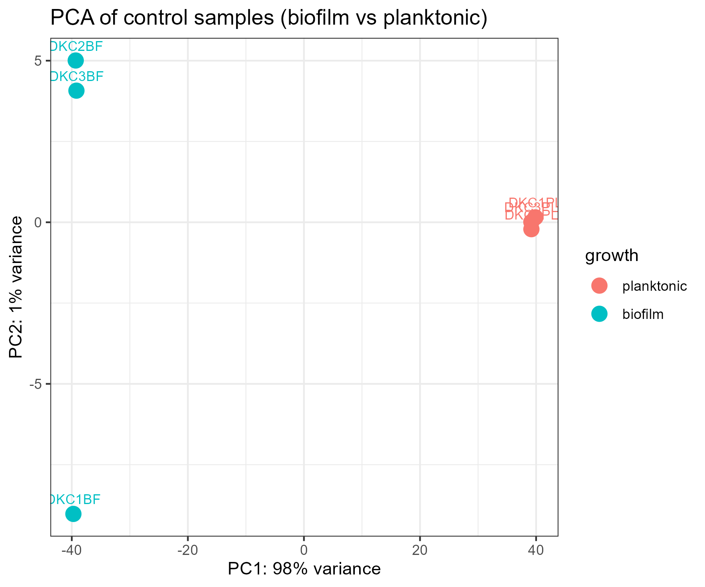
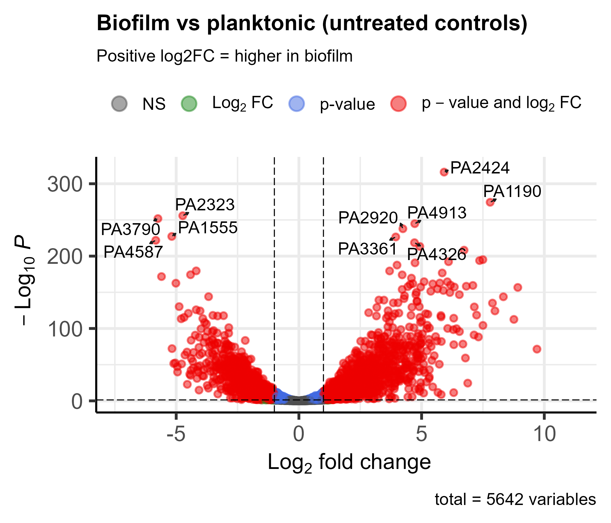
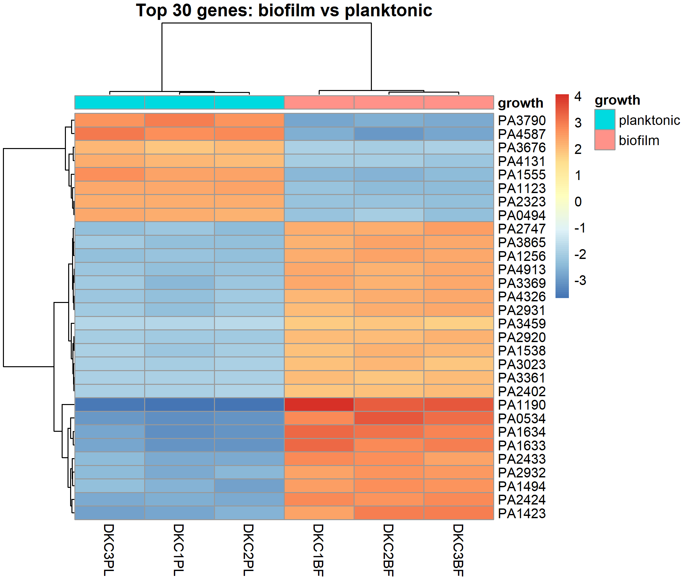

# Biofilm-rnaseq-practice
RNA-seq differential expression practice on a bacterial biofilm dataset (DESeq2, R)
# Biofilm RNA-seq practice: P. aeruginosa

Practice differential expression analysis of a public RNA-seq dataset,
comparing biofilm and planktonic growth. This is a learning project using
published data. I did not generate the data.

## Dataset
- GEO accession: GSE302777
- Organism: Pseudomonas aeruginosa 
- Platform: Illumina NovaSeq 6000
- Samples: 12
- Design: 4 conditions x 3 biological replicates
  - planktonic, untreated control
  - planktonic, midazolam 10 ug/ml
  - biofilm, untreated control
  - biofilm, midazolam 10 ug/ml
- Main comparison for this project: biofilm vs planktonic (untreated controls)

## Source paper
Barcelo IM et al. Analyzing the effects of benzodiazepines on the virulence
and biofilm formation of Pseudomonas aeruginosa. Scientific Reports 2025;16:2923.
DOI: 10.1038/s41598-025-32848-4

## Method
- Raw counts filtered to genes with at least 10 reads in total (5,678 -> 5,642 genes).
- Differential expression with DESeq2 (design: ~ growth), planktonic as reference.
- Fold changes shrunk with apeglm for plots; significance counts use unshrunk results.
- PCA and heatmap use variance-stabilised counts (vst).

## Results
- Thresholds: adjusted p < 0.05 and |log2 fold change| > 1
- Higher in biofilm: 1,489 genes. Higher in planktonic: 1,254 genes.
- Total counts per sample ranged from about 5.4 to 9.9 million, with no low-depth outliers.
- PCA: PC1 explains 98% of the variance and separates biofilm from planktonic samples; replicates cluster by group.
- Heatmap of the 30 most significant genes: 22 are higher in biofilm and 8 are higher in planktonic.

## Interpretation
Untreated biofilm and planktonic cells of P. aeruginosa differed widely in gene expression: 1,489 genes were higher in biofilm and 1,254 were higher in planktonic (adjusted p < 0.05, |log2FC| > 1, n = 3 per group), and PC1 alone explained 98% of the variance between the groups. Among the 30 most significant genes, 22 were higher in biofilm and 8 were higher in planktonic. KEGG enrichment of the differentially expressed genes highlighted oxidative phosphorylation, the TCA cycle, the ribosome and carbon metabolism, so changes cluster in central energy metabolism and protein synthesis, although this first enrichment did not separate up- and down-regulated genes. I have not yet compared these results with the source paper's biofilm findings, so I make no claim about agreement, and the data show association, not mechanism. This raises the question of whether the direction of change in these pathways differs between biofilm and planktonic cells.

## Limitations
- Public dataset (GSE302777) analysed for practice; I did not generate the data.
- Three biological replicates per group.
- Biofilm and planktonic cells also differ in growth conditions, so differences may reflect more than biofilm formation alone.
- KEGG enrichment shows where changes cluster, not the mechanism.

## Files
- data/ : count table and sample metadata downloaded from GEO
- scripts/analysis.R : full analysis, runs top to bottom
- results/ : differential expression table, QC and enrichment tables
- figures/ : QC plot, PCA, volcano plot, heatmap

## Status
Core analysis complete. Interpretation in progress.

